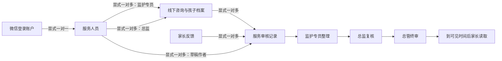

# Zion Rules For This Project

## 当前状态（2026-09-24 正式核对）

- 目标 `JmAxbl1MMe4`，当前部署 schema `2LeKE21ljDb`；简易方案梳理商品分类、问卷入口及既有服务动作流已正式同步。
- 扫码进场名单仅供管理和本场已授权签到人员读取；现返回并支持搜索报名人的完整联系电话，其他场次人员、代理和普通用户仍由动作流拒绝，名单接口继续排除入场码与孩子资料。
- 用户明确授权账号仅本人读写、默认角色关闭直接 AI/课程表访问。权限实测通过，工作人员身份和能力仍由后台维护。
- 免费课程姓名/手机报名 → 进群指引 → 工作人员核实实际到课 → 咨询申请及确认 → 孩子信息 → 老师记录 → 反馈回复。内部付费课程暂缓。
- 真实合成账号完成核心流程、并发最后一席、取消/重新报名、资料保存、查重及直接访问拒绝测试。文字和私有合成录音均生成 READY 草稿。
- `isUsernameAvailable` 使用主动作流的 `CHECK_USERNAME`，不再依赖客户端全局读取账号。
- 咨询总结 Agent `a3iok6bmd` 的 `maxRound=2`；录音第二轮附件提交需要这一设置。
- 合成业务记录和工作人员身份已清理；平台保护的合成 AI 会话、凭证账号及测试资产保留并记录。
- 70 项本地测试、23 WXML / 27 WXSS 官方编译通过。浏览器布局仅为间接证据；原生模拟器、真实微信登录/分享/相机/相册与小程序发布仍待验收。
- 9 月 10 日已按用户明确授权开启微信开发者工具服务端口并完成 Codex MCP 接入；官方连接检查通过。原生模拟器已恢复，首页公开课和客户入口已核对。现无待确认的接入权限，其他权限和正式同步无需再次申请。
- 详细交付与限制见 `docs/功能落实自查清单.md`。


Project: `JmAxbl1MMe4`

GraphQL endpoint:
- HTTP: `https://zion-app.functorz.com/zero/JmAxbl1MMe4/api/graphql-v2`
- Subscription: `wss://zion-app.functorz.com/zero/JmAxbl1MMe4/api/graphql-subscription`

Admin Bearer Token:
- The token from Zion "Connect Backend" is for local/server-side debugging only.
- Never commit it.
- Never hardcode it in mini program frontend code.
- If a frontend feature needs privileged work, create a Zion user event/action flow or a trusted backend call instead.

Sources read:
- Zion Headless BaaS docs: https://docs.functorz.com/docs/developers/headless_vibe_coding
- Zion user events docs: https://docs.functorz.com/docs/actions/reference/user_event_collection
- Zion permissions docs: https://docs.functorz.com/docs/publish_operate/permissions
- Zion data model docs: https://docs.functorz.com/docs/data/guide/database_configuration
- Live project schema from Zion MCP for project `JmAxbl1MMe4`

## 简易方案梳理问卷工单（2026-09-23）

- 2026-09-24 通过 Zion CLI 重新加载正式项目并核对“公开课报名”表。正式部署 schema 为 `EdyVRX674M9`；本次不新增表或字段，继续使用已部署的数据结构，并已同步管理员自定义开放时间的动作流校验。
- 一份问卷对应一条 `public_class_enrollment` 记录。工单状态保存在 `feedback_status`：`PENDING`（待处理）、`DRAFT`（处理中）、`CONFIRMED`（已完成）。管理员列表和详情必须继续通过主服务动作 `STAFF_CHILD_INTAKES` / `GET_CHILD_INTAKE` 读取，不能在前端直接放宽表权限。
- 管理员回复写入 `feedback_content`，保存草稿或发布统一调用 `SAVE_CHILD_FEEDBACK`。写入必须携带 `feedback_revision` 做并发校验；发布时由管理员选择家长可查看时间，动作流校验该时间不早于当前时间且不超过一年，并记录 `feedback_reviewer_id`、`feedback_confirmed_at` 和 `feedback_available_at`。已发布正文及开放时间不可覆盖。
- 家长只能读取自己报名记录。`DRAFT` 阶段以及确认后的等待期不返回 `feedback_content`；服务器当前时间到达已经校验并落库的 `feedback_available_at` 后，`GET_QUESTIONNAIRE` 才返回正文并设置 `canViewFeedback=true`。客户端本地时钟不能决定可见性。
- 网页 UI：二维码发放页只保留“问卷工单”入口；二级工单页按待处理、处理中、已完成筛选；工单详情负责保存和发布；家长问卷页负责显示进度与最终回复。

## Hard Rules

1. Always verify the live Zion schema before writing frontend calls.
   - Use Zion MCP `set_current_project`, then `get_project_schema`, `schema_table`, or `supportservice_graphql`.
   - Never guess table names, field names, action flow ids, or return shapes.
   - New mutable product data must be backend-first: create or verify the Zion table/field/actionflow, validate and sync backend, then wire the frontend to the verified API.
   - Do not ship new editable data as `utils/mock.js`, local storage, or hardcoded constants except as a clearly marked offline fallback.
   - If Zion schema editing is unavailable, stop and report the blocker instead of claiming the database was created.

2. Prefer Zion account/user-event semantics for login.
   - Zion docs say mini program login should use silent login to create or reuse `account`.
   - Avatar/nickname acquisition should update the account data.
   - Phone binding is an account binding/user-event concern; frontend cannot decrypt a phone number.

3. The frontend must not pretend to have a real phone number.
   - WeChat `getPhoneNumber` returns `code` in modern base libraries, or legacy encrypted payload.
   - The backend must exchange the phone `code` with WeChat and write the real number.
   - Store raw phone codes only for debugging when explicitly needed; do not display them as real phone numbers.

4. Use the actual project tables confirmed from schema.
   - `account`: has `wechat_nickname`, `wechat_avatar_url`, `wechat_openid`, `wechat_unionid`, `fz_phone_number`, `last_login_at`.
   - `wechat_login_record`: has `account_id`, `wechat_nickname`, `wechat_avatar_url`, `wechat_openid`, `login_at`, `raw_profile_json`.
   - `consultation_order`, `consultation_session`, and `consultation_message` are the chat/payment domain tables.

5. Distinguish test logging from real login.
   - `wechat_login_record` is suitable as an audit/debug record.
   - A real logged-in user should be represented by `account`, with openid/unionid and phone handled by Zion/WeChat backend logic.

6. GraphQL rules.
   - Use the deployed GraphQL endpoint only with fields verified from schema.
   - The HTTP endpoint for this project is `https://zion-app.functorz.com/zero/JmAxbl1MMe4/api/graphql-v2`.
   - The subscription endpoint for this project is `wss://zion-app.functorz.com/zero/JmAxbl1MMe4/api/graphql-subscription`.
   - Do not place the Admin Bearer Token in `utils/zion.js`, page JS, WXML, checked-in docs, or any shipped client asset.
   - For hand-written where filters, use Zion's operator-first grammar.
   - Do not use unverified camelCase fields such as `phoneNumber` or `profileImageUrl`; this project uses names like `fz_phone_number` and `wechat_avatar_url`.
   - Frontend changes that alter user/profile/order/service-provider data must write through verified backend fields. After a successful backend write, local storage may only mirror the backend response for UI responsiveness.

7. Permission rules.
   - Zion permissions are RBAC + ABAC.
   - In mini programs, users are normally silently logged in; do not assume an anonymous role model.
   - Zion Plugin 2.7.7 supports permission changes through GET_TABLE_PERMISSION and UPDATE_ROLE_TABLE_PERMISSION. Read each role first, apply changes through the official tools, sync, then verify runtime access. Earlier editor-only guidance applies to the old plugin.
   - After schema or permission changes in Zion, backend sync/deploy is required.

8. Schema-edit rules.
   - Load schema first.
   - Inspect current table/field names.
   - Apply schema edits only through Zion MCP schema tools.
   - Validate, then sync backend.
   - Do not manually add foreign-key id fields when a Zion relation is the right model.

## Profile Storage

Status on 2026-07-05:

- Created and synced a real visible profile table in Zion.
- Table display name: `账户资料`
- API name: `account_profile`
- Zion generated a one-to-one relation from `account` to `account_profile` through `account.account_profile_id`.
- Current editable profile fields:
  - `user_name` TEXT
  - `avatar_url` TEXT
  - `city` TEXT
  - `address` TEXT
  - `gender` TEXT
  - `birthday` DATE
  - `phone` TEXT
  - `wechat_avatar_url` TEXT
  - `location_info` JSONB
- Runtime profile save must write `account_profile` first, then set `account.account_profile_id`.
- Keep `account.username`, `account.wechat_nickname`, and `service_provider.display_name` in sync for app-wide display.
- Do **not** write `account_profile` into `account.oauth2_user_info_map`. That field is Zion OAuth internals (`WECHAT` only); polluting it breaks `loginWithWechatMiniApp`.
- `account.oauth2_user_info_map.account_profile` was a legacy compatibility mirror and must not be updated anymore.

Runtime rule for the edit-profile page:

- Read and write `account_profile` as the source of truth.
- Also keep `account.username`, `account.wechat_nickname`, `account.wechat_avatar_url`, and `service_provider.display_name` in sync for app-wide display.
- Local storage may mirror the backend response for responsiveness, but must not be treated as persistent truth.

## Login Direction For This App

The current mini program code should move toward:

1. `wx.login` obtains a temporary login code.
2. Backend/Zion user-event or action flow exchanges code for `openid`.
3. Zion creates or updates `account`.
4. Avatar/nickname update `account.wechat_nickname` and `account.wechat_avatar_url`.
5. Phone authorization sends WeChat phone `code` to backend.
6. Backend exchanges phone code and writes `account.fz_phone_number`.
7. Frontend displays logged-in UI only after the backend returns the confirmed account data.

Until the real Zion user-event/action flow exists, `wechat_login_record` may be used only as a temporary audit record, not as proof that a real account login is complete.

## H5 WeChat OAuth Login (2026-09-19)

- 网页端使用天启无书公众号 AppID `wx6dafecca8d5fd24e` 构造 `oauth2/authorize` 地址；该 AppID 是公开标识，可由部署环境 `WECHAT_OA_APP_ID` 覆盖。
- 微信回调的一次性 `code` 由服务端携带部署平台中的 `WECHAT_OA_APP_SECRET` 向微信换取用户资料；随后按公众号 AppID 与 openid 生成稳定 Zion 用户名，先用 `authenticateWithUsername(register:false)` 登录，仅在 `ACCOUNT_DOES_NOT_EXIST` 时用 `register:true` 注册，并回写 `account.wechat_*` 字段。2026-09-20 运行时确认：已有账号使用 `register:true` 会返回 `USERNAME_ALREADY_EXISTS`，不能用于恢复登录。
- 网页微信账号的 `wxh5_` + 36 位十六进制用户名是稳定认证标识，保存个人资料时必须保留；可编辑昵称保存在 `account_profile.user_name` 和 `account.wechat_nickname`。
- 公众号 AppSecret 只配置在本地 `.env` 或 Vercel/Zeabur 的加密环境变量中，不得进入 GitHub。Zion JWT 只放入 HttpOnly 签名会话。
- 未配置 `WECHAT_OA_APP_SECRET` 时保留 Zion `loginWithWechat` 兼容路径；2026-09-19 运行时探测确认该 mutation 存在，但当前项目尚未设置 Zion 网页应用凭据，因此生产路径使用服务端公众号 OAuth。
- 公众号后台网页授权域名为 `www.apply.tianqiwushu.cn`，网页回调路径为 `/api/wechat-oauth-callback`。

## Manager / Service Provider Direction

经理端不是普通用户 UI 的一个隐藏页面，必须有后端身份和权限支撑。

Required data model:

- `service_provider`: service staff profile bound to `account` through a Zion relation.

Current business identity model（2026-09-21）:

- 已登录用户只使用三种业务身份：`管理`、`代理`、`用户`，不再增加第四种前台业务身份。
- `管理`：存在 `service_provider.service_kind = STAFF` 且 `service_status = ACTIVE` 的关联记录；实际能力继续由 `can_reply`、`can_accept_order` 等后端字段控制。
- `代理`：存在 `service_provider.service_kind = AGENT` 且 `service_status = ACTIVE` 的关联记录；代理身份不能因共用 `service_provider` 表而获得管理接单或回复能力。
- `用户`：没有启用中的 `STAFF` / `AGENT` 关联记录。`account.user_type` 只作兼容展示，不可单独作为授权依据。
- 正式启用账号只保留三个：刘曜恺 `account.id = 1000000000000019`（管理）、周流君騰 `account.id = 1000000000000020`（用户）、程思琦 `account.id = 1000000000000021`（管理）。刘曜恺网页账号关联 `service_provider.id = 14`，并承接原工作人员的 `advisor.id = 5` 与历史课程关系。

Status on 2026-09-21（身份管理）:

- 管理工作台新增“身份管理”，只允许启用中的 `STAFF` 且同时具备 `can_reply` / `can_accept_order` 的当前登录账号调用。
- `LIST_ACCOUNT_IDENTITIES` 与 `SET_ACCOUNT_IDENTITY` 都在主服务动作流内重新核验当前账号；客户端传入的角色、昵称或缓存不作为授权依据。
- 管理只能修改其他用户，不能在该页面降低自己的管理身份，避免误操作导致系统无可用管理账号。
- 身份变更同时更新 `account.user_type` 兼容显示和 `service_provider` 真实业务身份；改成“用户”时保留历史服务人员记录但将其设为 `INACTIVE`，避免破坏已有咨询关系。
- 新增 `identity_change_log`（身份变更记录），通过两个显式账户关系记录操作人与目标用户，并保存原身份、新身份和备注。Anonymous User 与 Logged-in User 对该表的直接查询、写入、修改、删除和统计均关闭，只有动作流服务端写入。
- `LIST_ACCOUNT_IDENTITIES` 必须固定使用 `account.fz_deleted = false`；Zion 官方注销接口会保留不可登录的系统墓碑记录，管理页不得把注销账号当成可管理用户返回。
- 清理未绑定的旧表：`wechat_login_record`（0 条）、`advisor_favorite`（0 条）、`recommendation`（4 条早期占位数据）、`ud_banbenshenhe_ebcabf`（1 条早期占位数据）。线下预约、记录、反馈、总结等空表仍被正式流程引用，全部保留。

Status on 2026-07-04:

- Created and synced `service_provider`.
- Added Zion relations:
  - `account` one-to-one `service_provider`, generating `service_provider.account_id` with unique constraint `service_provider_account_id_key`.
  - `service_provider` one-to-many consultation sessions.
- Added `consultation_session.service_provider_id` through the Zion relation.
- The project is still `pre_type_system_refactor`, so status-like fields were created as `TEXT` instead of enum types.
- 权限修改需通过当前官方 Zion CLI 的权限工具执行并在同步前回读 Anonymous User 与 Logged-in User；编辑器仍可用于人工复核。
- Historical note: the earlier CLI could not configure permissions. Since Zion Plugin 2.7.7, the official CLI supports role/table permissions and row-condition binding tools.

Status on 2026-07-04 later（历史记录，经理身份已在 2026-08-16 校正）:

- Added `consultation_session.customer_avatar_url` so manager pages can show the customer's real login avatar instead of an anonymous placeholder.
- 测试客户仍为 `account.id = 1000000000000002`（“测试客户小安”）。
- 当前真实经理身份为 `account.id = 1000000000000010`（“刘曜恺”）。旧的 `1000000000000003 / 林静经理` 记录不再作为前端默认经理。
- 当前 `service_provider.id = 1` 绑定 `account.id = 1000000000000010` 和 `advisor.id = 5`，`service_status = ACTIVE`、`can_reply = true`、`can_accept_order = true`。
- Frontend temporarily exposes a manager workbench entry that reads the backend-created active `service_provider` identity directly. Remove or protect this direct entry before production release.
- Verified an end-to-end test in Zion: customer paid order → waiting session with `customer_nickname` and `customer_avatar_url` → manager accepted session → customer and manager messages were both saved.
- Removed old/unused backend tables on 2026-07-04: `manager_profile`, `service_provider_wallet_log`, `service_provider_withdrawal`, and `service_quick_reply_template`.

Status on 2026-07-09:

- Removed manager personal withdrawal UI and `service_provider` fields `can_withdraw`, `completed_order_count`, `withdrawable_income` (synced to Zion backend). Managers no longer see order count or withdrawable amount on profile.
- Added `consultation_message` recall audit fields: `is_recalled`, `recalled_at`, `recalled_by_account_id`, `recalled_content`, `visible_to_customer`, `replaces_message_id`, `replaced_by_message_id`.
- Manager chat: long-press own message within 60s to recall; manager-only recall notice with re-edit; customer queries filter `visible_to_customer = true`.

Permission source of truth:

- Frontend may hide manager pages for user experience, but it is not security.
- The manager UI must be entered from customer `profile` only after backend confirms `service_provider`; do not expose it as a normal public tab or public menu.
- The manager page itself must re-check backend `service_provider` access and redirect ordinary users back to `profile`.
- The real permission must be in Zion Permission Management.
- A user can reply only when their related `service_provider` has:
  - `service_status = ACTIVE`
  - `can_reply = true`
- A user can accept orders only when:
  - `service_status = ACTIVE`
  - `can_accept_order = true`

Do not implement manager access by only checking local storage, nicknames, or frontend route names. Use backend relation and row-level permission filters.

## WeChat Login Action Flow

Action Flow:
- Display name: `小程序微信登录`
- Name: `miniapp_wechat_login`
- ID: `4e0d236b-9a2c-4510-9c73-8cdade71e9e3`
- Runtime version used by GraphQL: `1`

Inputs:
- `login_code` TEXT
- `phone_code` TEXT
- `nick_name` TEXT
- `avatar_url` TEXT
- `raw_profile_json` JSONB

Outputs:
- `success` BOOLEAN
- `account_id` BIGINT
- `wechat_openid` TEXT
- `phone_number` TEXT
- `message` TEXT

Status on 2026-07-03:
- The Action Flow was created, validated, and synced to Zion backend.
- A direct GraphQL invocation succeeded with `versionId: 1`.
- Current output intentionally returns `success: false` until the WeChat backend exchange is configured.
- Frontend `utils/zion.js` must call `fz_invoke_action_flow`; do not restore direct writes to `wechat_login_record` for login.

GraphQL invocation shape:

```graphql
mutation InvokeWechatLoginAction($args: Json!) {
  fz_invoke_action_flow(
    actionFlowId: "4e0d236b-9a2c-4510-9c73-8cdade71e9e3",
    versionId: 1,
    args: $args
  )
}
```

## Login Status 2026-07-05

Verified against the live runtime GraphQL schema (introspection on `graphql-v2`):

- Zion 内置微信登录可用：`loginWithWechatMiniApp(code: String!, createIfNotExists: Boolean) -> LoginResult { account { id username phoneNumber profileImageUrl permissionRoles } jwt { token } }`。
  后端用小程序 `wx.login` code 调微信 code2session（项目已配置 AppSecret），自动创建/复用 `account` 并写入 openid。这是被 Zion 微信行为识别的真实登录。
- 手机号（微信付费组件不可用期间的替代路径，均为 Zion 内置 mutation）：
  - `sendVerificationCodeToPhone(telephone: String!, verificationEnumType: BIND) -> Boolean`
  - `bindPhoneNumberByVerificationCode(telephone: String!, verificationCode: String!) -> Boolean`（需携带登录 JWT，绑定后写入 `account.fz_phone_number`）
- 前端实现：
  - `utils/zion.js`：`loginWithWechat` 现在先走 `loginWithWechatMiniApp` 真实登录并保存 JWT，再同步 `wechat_nickname` / `wechat_avatar_url`，最后读回 `account` 确认；`sendPhoneVerificationCode` / `bindPhoneNumberByCode` 提供短信绑定。
  - `pages/profile`：登录按钮改为微信一键登录（不再被 getPhoneNumber 阻塞）；登录后如 `fz_phone_number` 为空，展示手机号短信绑定面板。
- 保留 `miniapp_wechat_login` Action Flow 调用路径：一旦微信手机号快速验证组件购买开通，`getPhoneNumber` 的 `phone_code` 仍会走该 Action Flow 换取手机号。
- 2026-07-05 已实测：短信验证码可以正常发送并完成绑定（真机验证通过，`fz_phone_number` 已写入）。

Update 2026-07-06 later（登录改为微信身份）:

- 登录方式改为 **微信身份登录**（不再使用手机号短信验证码）：
  - `loginWithWechatIdentity({ nickName, avatarUrl })`：`wx.login` → `loginWithWechatMiniApp` 按 `wechat_openid` 创建/复用唯一 `account`（一个微信一个账户）→ 首次登录必须设置唯一用户名 + 头像并写入 `account_profile` / `account.username`。
  - `isUsernameAvailable(userName, excludeAccountId)`：检查 `account.username` 与 `account_profile.user_name` 全局唯一。
  - 老用户再次登录：若后端已有用户名和头像，可直接点「微信登录」恢复账户，无需重复填写。
  - 头像本地临时文件会先 `uploadImage` 上传到 Zion 图片资产库再绑定 `avatar_image_id`。
- 手机号短信登录代码（`sendLoginVerificationCode` / `loginWithPhoneNumber`）保留在 `utils/zion.js` 但 profile 页已不再使用。

Update 2026-07-05 later（按产品要求调整）:

- 登录方式改为手机号 + 短信验证码直接登录：
  - `sendLoginVerificationCode`：先查 `account.fz_phone_number` 是否已有账户，已注册发 `LOGIN` 码，未注册直接发 `SIGN_UP` 码并返回 `mode`。**不能**先尝试 `LOGIN` 再回退 `SIGN_UP`——未注册手机号用 `LOGIN` 类型也能发码成功，但登录时 `register:false` 会报 `bad verification code`。
  - `loginWithPhoneNumber(telephone, code, profile, codeMode)`：调 `authenticateWithPhoneNumber`，`register` 参数必须与发码类型一致（`LOGIN` → `register:false` 匹配原账户直接登录；`SIGN_UP` → `register:true` 自动建账户）。
  - 关键坑（2026-07-05 真机踩过）：验证码类型与 `register` 不一致时返回 `VERIFICATION_CODE_AUTHENTICATION_FAILED (bad verification code)`。已注册手机号发的是 LOGIN 码，却带 `register:true` 去登录就会失败。前端必须保存发码时的 `mode` 并原样传回。
  - 关键坑（2026-07-06）：未注册手机号若误发 LOGIN 码，表现与「验证码错误」完全相同；2026-07-06 已改为发码前先查 account 表决定类型。
  - 老账户重登时不覆盖后端已有昵称/头像，只在后端缺失时补写。
- 「已绑定手机号」展示从 profile 页挪到 profile-edit（编辑个人资料）页，带「已验证」标记，只读。
- 微信一键登录（`loginWithWechatMiniApp`）与短信绑定（`bindPhoneNumberByCode`）代码保留在 `utils/zion.js`，未来可作为微信账号关联能力使用。

## Avatar Upload Status 2026-07-06

个人资料头像已改为真实上传绑定后端：

- `account_profile` 表新增 `avatar_image` IMAGE 列（生成 `avatar_image_id`），已通过 MCP `schema_table` 添加并 `sync_backend` 部署。
- 历史坑：旧代码把微信 `chooseAvatar` 返回的本地临时路径（`wxfile://tmp_...`）直接存进了 `avatar_url` TEXT 字段，换设备/重启后全部失效。修复后保存资料时若头像仍是本地文件，先走 `imagePresignedUrl` 上传到 Zion 图片资产库，再把 `avatar_image_id` 写入 `account_profile`。
- 前端新增 `utils/md5.js`（上传需文件 MD5 Base64）与 `utils/zion.js` 的 `uploadImage(filePath)`。
- `normalizeAccount` 头像优先级：`avatar_image.url`（每次查询重新签名，永不过期）> `avatar_url` 文本（老数据兜底）> `account.wechat_avatar_url`。
- 匿名角色已验证可读 `account_profile.avatar_image { url }`；`account_profile_set_input` 含 `avatar_image_id`。
- 遗留：`service_provider.avatar_url` 仍是 TEXT，保存资料时同步进去的签名 URL 会过期；后续应同样迁移为 IMAGE 列。

## Advisor Table Status 2026-07-06

首页/搜索页的专家数据已改为后端优先：

- `advisor` 表（显示名「答主」）新增 `avatar_image` IMAGE 列（生成 `avatar_image_id`），已通过 Zion MCP `schema_table ADD_FIELDS_RELATIONS` 添加并 `sync_backend` 部署。
- 三张原 Google 托管的专家图片已上传到 Zion 图片资产库（PUBLIC_READ），imageId：`1020000000000001` / `1020000000000002` / `1020000000000003`。
- 已插入 6 条 advisor 记录（id 5–10）。2026-08-16 核对线上数据时发现 5/6 重名且 7–10 姓名为空，现已恢复为：刘曜恺、曜恺、郝婉彤、梅朵、白智杰、周流君腾；全部 `status = ACTIVE`、`price_per_hour = 200`、`rating = 4.9`。当前 id 9 尚未绑定 `avatar_image`，其余记录保留现有图片资产。
- 图片静态 URL 是带签名的（篡改日期前缀返回 403），因此不要把 URL 落库到 TEXT 字段；前端必须每次查询 `avatar_image { url }`，由 Zion 返回新鲜的签名 URL。`avatar_url` TEXT 列保留为空作兼容。
- 匿名（未登录）角色可以读取 `advisor` 表和 `avatar_image.url`，真机未登录时首页也能出图。
- 前端：`utils/zion.js` 的 `listAdvisors` / `getAdvisor` 已加查 `avatar_image { id url }`，`normalizeAdvisor` 优先使用 `avatar_image.url`；首页与搜索页默认后端数据，`utils/mock.js` 仅作为后端不可达时的离线兜底。
- 换头像/名字直接在 Zion 数据可视化里改 advisor 行即可，前端会自动同步。
- 微信小程序后台需把 `zion-app.functorz.com`（request）和 `fz-zion-static.functorz.com`（downloadFile）加入合法域名，否则真机不出图。

## Course Table Status 2026-07-08

课程页已改为后端优先，可在 Zion 数据可视化里直接维护课程与课时。

### `course` 表（显示名「课程」）保留字段

- `title` TEXT — 课程标题
- `subtitle` TEXT — 副标题
- `cover_url` TEXT — 封面 URL（兼容兜底）
- `cover_image` IMAGE — 封面图片（推荐，生成 `cover_image_id`）
- `duration_text` TEXT — 时长展示（如「6小时32分」）
- `badge` TEXT — 角标（如「热门」「新课」）
- `sort_order` BIGINT — 排序（越小越靠前）
- `enabled` BOOLEAN — 是否上架（前端只展示 `true`）

### 已删除字段（与前端已移除 UI 同步，2026-07-08）

- `description` / `category` / `tags_json` / `highlights_json`
- `instructor_name` / `instructor_title` / `instructor_avatar_url` / `instructor_avatar`
- `lesson_count` / `student_count` / `rating`
- `price` / `original_price`

### `course_lesson` 表（显示名「课程课时」）保留字段

- `title` TEXT — 课时标题
- `duration_text` TEXT — 时长（如「18:20」）
- `sort_order` BIGINT — 排序
- `video_url` TEXT — 视频 URL（兼容兜底）
- `video` VIDEO — 视频资产（推荐）
- 关系：`course` 1-N `course_lesson`，课程侧 `course_lesson`，课时侧 `course_id`

### 已删除字段

- `is_free`（试看/付费逻辑已移除）

### 运维说明

- 已通过 Zion MCP `DELETE_FIELDS_AND_RELATIONS` + `project sync-backend` 部署。
- 前端：`utils/zion.js` 的 `listCourses` / `getCourse` 只查询上述保留字段；`utils/mock.js` 离线数据已同步精简。
- 上传课程：在「课程」表新增行并设 `enabled = true`；课时在「课程课时」表新增并关联课程。
- 已用 `scripts/seed_courses.py` 将 `utils/mock.js` 中 6 门预览课程写入后端（course id 1–6，共 15 条课时）；匿名可读，课程页默认走后端数据。

## Consultation Chat Status 2026-07-08

聊天消息与订单「问题方面」的 join 链路：

- `consultation_message.session_id` → `consultation_session.order_id` → `consultation_order.problem_category` / `issue_summary`
- 2026-07-08 已清空全量 `consultation_message`（10 条历史消息），并重新 seed 测试会话：
  - order id `17`，`problem_category=恋爱情感`，`issue_summary=我和男朋友最近总是吵架...`
  - session id `13`（active，已绑定 order/service_provider）
  - 5 条测试消息（3 客户 + 2 经理），join 验证脚本 `scripts/verify_consultation_messages.py 13` 全部通过
- 前端修复：
  - `utils/zion.js` 的 `getSessionMessages()` 改为 GraphQL `where: { session_id }` 过滤
  - `listManagerSessions()` 额外查询 `consultation_order`，`normalizeManagerSession()` 从订单取 `problemCategory` / `issueSummary`
  - **咨询会话 ID 绑定**：`customer_service_binding` 与 `consultation_session` 建立 **1:1 关系**（`consultation_session.customer_service_binding_id` 唯一）；支付/续费只更新该会话，不再新建；发消息时只解析已绑定会话
  - **服务计时**：支付成功或客户首条消息**不**启动倒计时；仅经理发出首条回复时写入 `started_at` / `expires_at` 并开始 1 小时倒计时（`startConsultationServiceTimer` / `resolveEffectiveSessionExpiry`）。**续费后一律清空计时字段**，等经理再次回复后重新计时。
- 测试脚本：`scripts/seed_consultation_test.py`（创建订单+会话+示例消息）、`scripts/verify_consultation_messages.py`（验证 join）
- 实机测试：profile 页微信登录 → advisor 支付 → chat 发消息；经理端 profile 进工作台接单 session `13` 后回复

## Customer Service Binding Status 2026-07-08

客户与经理/答主为一次性绑定关系：客户首次成功预约并支付后写入绑定，此后不能预约其他答主；经理被动接单；仅 `user_type` 为 `admin` / `super_admin` 的账户可调用 `transferCustomerServiceBinding` 做移交。

### `customer_service_binding` 表（显示名「客户服务绑定」）

- `binding_status` TEXT — 默认 `ACTIVE`
- `bound_at` TIMESTAMPTZ — 首次绑定时间
- `transfer_note` TEXT — 移交备注
- `last_transferred_at` TIMESTAMPTZ — 最近移交时间
- 关系（Zion 自动生成 FK）：
  - `customer_account_id` → `account`（**唯一约束**：一位客户仅一条绑定）
  - `advisor_id` → `advisor`（答主）
  - `service_provider_id` → `service_provider`（服务人员）
  - **`consultation_session` one_to_one `customer_service_binding`**（2026-07-09）：绑定表与咨询会话表 1:1；`consultation_session.customer_service_binding_id` 有唯一约束，同一位客户的会话 ID 固定不变，续费/再次支付只更新该会话字段
- 答主 ↔ 服务人员：`advisor` 与 `service_provider` 已建立 1:1 关系（`service_provider.advisor_id`）

### 前端行为

- `utils/zion.js`：`getCustomerServiceBinding` / `assertCanBookAdvisor` / `resolveAdvisorServiceProvider` / `ensureCustomerServiceBinding` / `transferCustomerServiceBinding`；`getBoundConsultationSession()` 优先从 `customer_service_binding.consultation_session` 关系读取固定会话
- `utils/payment.js`：支付前校验绑定；首次支付成功后落库绑定并创建/关联唯一会话；续费延长同一会话
- `pages/advisor` / `pages/index` / `pages/search`：已绑定客户访问其他答主时拦截并提示

### 运维

- 已通过 MCP 创建表并 `sync-backend` 部署
- `scripts/seed_customer_service_binding.py`：将 `service_provider.id=1` 关联到 `advisor.id=5`（可按脚本内常量调整）
- `scripts/link_binding_consultation_session.py`：为已有绑定补写 `consultation_session.customer_service_binding_id`，并关闭重复会话
- `scripts/seed_test_customer_provider1.py`：一键 seed **测试客户小安**（account `1000000000000002`）+ `service_provider` id `1`（刘曜恺）+ 绑定/订单/会话/示例消息

## Test Result 2026-07-03

Tested via Zion MCP `supportservice_graphql`:

- `insert_wechat_login_record_one` works with verified fields:
  - `wechat_nickname`
  - `wechat_avatar_url`
  - `login_at`
  - `raw_profile_json`
- The test inserted a mock avatar URL successfully.
- The inserted mock record returned `wechat_openid: null`.
- The mock record was deleted after verification.

Conclusion: current frontend GraphQL can write a login audit record, but it does not perform real WeChat login. Real login still requires a Zion user-event/action-flow/backend step that exchanges `wx.login` code for `openid` and exchanges `getPhoneNumber` code for `fz_phone_number`, then updates `account`.


### 2026-09-09 权限确认后续

用户已明确确认账号仅本人读取/修改、游客与登录用户直接 AI 调用关闭，并授权同步。编辑器已保存账号主表及账户资料的归属过滤，游客账号查询/修改/统计和账户资料访问已关闭；两类角色的 AI 允许列表均为空。用户名查重改用主服务动作 `CHECK_USERNAME`，只返回布尔值，排除账号取自服务端登录身份；70 项本地测试通过。新增课程字段被 Zion 自动赋予了默认角色直接权限，该项额外收紧仍等待自动审批要求的明确确认。以上仍为草稿，正式联调尚未完成。

### 2026-09-10 正式联调状态更新

上述 9 月 9 日草稿状态已被后续授权与正式部署取代：正式版本 `vDAB57E4rEM` 已回读确认，核心流程、名额并发、账号归属权限、直接访问拒绝及文字/录音总结联调通过。详见 `docs/咨询服务交付状态.md` 和 `.codex-work/course-reference/deployed-final-state.json`。117 文件小程序纯源码包经用户授权发送至微信官方预览服务，二维码已成功生成；尚未发布正式小程序，手机设备能力仍待验收。


### 2026-09-11 最新交付状态

正式 schema 已更新并回读为 `B9K5XJZMbDB`，课程/工作人员预约分页已同步。小程序 UI 与课程发布交互修复共 109 项本地测试通过，24 WXML / 28 WXSS 官方编译通过。微信官方开发者工具已上传 `1.0.20260911` 并生成同源码预览二维码，121 文件纯源码 ZIP 已更新；公众平台仍需管理员扫码登录，尚未提交审核或正式上线。用户报告的课程发布失败仍待新版手机复测，当前证据不足以确定唯一根因。详情见 `outputs/wechat-release-2026-09-11/发布说明.md`。


### 2026-09-11 二阶线上共修展示更新

正式版本 `XAgrmdNbOvm` 已回读；新增 `course.description`（TEXT，可空），用于完整课程介绍。新增真实课程 `id=7`：《透过现象·直击本质》二阶线上共修营·03期，展示“付费”，已建档680元、未建档1680元的说明均存于后端介绍。首页只推荐 `badge=付费` 的课程，旧有课程和免费权益保留；这不等同于实现支付或资格校验。用户明确确认清空 `advisor` 5–10 号头像引用及 `course` 1–6 号人物封面，未删除资产原文件、用户个人头像或课程内容。详见 `outputs/course-home-2026-09-11/`。

## 代理首次免费咨询预约（2026-10-03）

- 推荐客户页面为已核实到课的公开课报名提供代约入口；代理只能为 `course_referral.referrer_id` 等于本人账号的客户提交。
- `GET_AGENT_APPOINTMENT` / `CREATE_AGENT_APPOINTMENT` 使用现有公开课与线下咨询服务动作流，在后端校验启用中的代理/管理身份、推荐归属、报名归属、实际到课及负责老师接单能力。
- 首次代约无需支付，保存到 `offline_appointment`，状态为 `PENDING`；咨询主管通过现有 `CONFIRM_APPOINTMENT` 确认具体时间。期望时间不代表已占用老师时段。
- 咨询主管路由（2026-10-08）：客户自约 `CREATE_APPOINTMENT` 与代理代约 `CREATE_AGENT_APPOINTMENT` 的 `provider_id` 统一写入咨询主管程思琦 `service_provider.id = 15`（常量 `CONSULTATION_SUPERVISOR_ID`），不再按公开课 `organizer_id` 分配；她负责确认时间并查看全部预约资料与孩子档案。主管停用或关闭接单时报错，不回落给公开课老师。线上节点 `g3oknp94t` 用 `scripts/stage-supervisor-routing.js` 做最小替换。
- 后续5次咨询（2026-10-08）：流程为 公开课到课 → 代理代约首次免费咨询 → 首次咨询发生并建立 `child_info` 档案（`COMPLETED`，或 `CONFIRMED` 且 `confirmed_at` 已过）→ 家长在“我的线下咨询”购买5次咨询（3999元）→ 家长自行预约，咨询主管确认。家长不能再自助申请首次免费咨询。
  - 商品是 `public_class.product_kind = CONSULT_PACKAGE` 的一行（价格取 `registration_fee`），沿用课程支付链路 `PREPARE_COURSE_PAYMENT` / `CONFIRM_COURSE_PAYMENT`；支付成功生成该商品的 `public_class_enrollment` 作为权益。`PREPARE_COURSE_PAYMENT` 校验首次咨询档案；`ENROLL` / `GET_CLASS` / `SAVE_CLASS` 拒绝该商品；`COURSE_SCOPE` 让它不出现在课程列表和名册。可重复购买：权益报名只建一条，每笔 `PAID` 的该商品订单增加 5 次（重复购买不进入 `PAID_REVIEW`）。页面展示“单次咨询 ￥1000 · 5次咨询 ￥3999”，不提供单次购买。
  - `GET_PACKAGE` 返回商品、资格、已约/剩余次数；`CREATE_APPOINTMENT` 只接受已购家长，`request_key = package:<权益报名id>:<1..5>` 由唯一约束防止超约，取消的场次可重约；同时只能有一条待确认。新预约 `enrollment_id` 仍指向已核实的公开课报名（沿用 `CONFIRM_APPOINTMENT` 校验），`child_info` 复制最近档案，`staff_note = 5次咨询 · 第N次`，`provider_id` 为咨询主管。
  - 线上节点 `g3oknp94t`、`sui9sl3ko` 用 `scripts/stage-consultation-package.js` 做断言替换。
- 接单权限（2026-10-08）：新预约默认挂咨询主管程思琦；所有可接单管理（`service_kind = STAFF` 且 `can_accept_order`）都能在工作台看到全部预约、打开资料并确认。谁确认，`provider_id` 就转给谁负责；仅可回复的老师仍只能处理分配给自己的预约。总结草稿流 `db7162d9` 仍按负责人校验。线上用 `scripts/stage-package-repurchase.js` 断言替换。
- 确定性 `request_key = agent-first:<客户账号>` 使用已核实的唯一约束防止重复提交；已有其他有效咨询记录不能再次申请首次免费咨询。取消后可重新提交该次预约。
- 代理只能读取该次预约的姓名、电话、困扰、时间和状态，不返回孩子档案、老师记录或反馈。普通客户不能调用代理代约操作。
- 本次没有改动客户自行预约或咨询付费规则；付费后客户自约流程留待后续实施。
- 后台单独追加预约节点逻辑，保留读取到的线上其他节点代码；已同步部署 schema `0ELZbD10jBk`。真实合成账号完成代约、重复提交、老师确认、代理查状态及客户拒绝测试，合成业务记录已清理。

### 2026-10-08 服务管理中修改备注与提交档案

- 独立孩子档案详情不显示咨询安排、录入说明和空的咨询反馈区域。
- 已分配且有回复权限的管理人员在服务管理中点击“修改档案”，修改档案内的备注后统一点击“提交档案”。管理端其他孩子资料保持只读；没有单独的保存备注按钮。
- `SAVE_CHILD_ARCHIVE` 只更新 `child_info.remarks`（可清空，最多 2000 字），保留其余资料、来源元数据和所有账号、管理、报名关系。详情返回 `updated_at`，提交带上 `previousUpdatedAt` 并做条件更新，避免覆盖并发修改。
- 原家长 `SAVE_CHILD_INFO` 的权限和确认预约要求保留。旧版缓存的 `SAVE_CHILD_REMARKS` 仅作兼容，仍限定负责工作人员。

## 我的方案内继续反馈（2026-10-09）

- “我的方案”沿用客户端现有页面，汇集孩子档案、咨询方案与原问卷入口；“我的”里的现有方案入口也能识别独立孩子档案。客户打开方案详情，在“方案反馈”中提问与反馈；负责老师从服务管理打开同一档案回复。无需新增导航或单独入口。
- `offline_appointment` 已绑定客户和负责老师且状态为 `PENDING`、`CONFIRMED`、`COMPLETED` 或 `孩子档案` 时开放方案反馈；不再要求咨询已完成，不改变实际咨询状态。未绑定与已取消的记录不开放。
- 复用已核实的 `consultation_feedback` 表存储每条消息，`advice_key = __consultation_dialogue__` 区分对话，`author_id` 保留实际登录账号。该标识不得用作执行建议标识，普通反馈列表排除这类消息，旧反馈回复接口拒绝处理对话消息；文字总结仍可整理本次对话并正确区分说话人。
- `GET_CONSULTATION_DIALOGUE` / `SEND_CONSULTATION_MESSAGE` 在后端检查有效状态、客户账号及实际负责老师与回复权限。客户端传入的角色、作者、账号不能改变发信身份；其他管理人员的预约处理权限不代表能进入该对话。
- 消息最多6000字。请求号包含咨询编号和登录账号，依托现有唯一约束防止重试重复发送；历史按编号分页，新增消息按递增编号补拉。详情展开后每8秒刷新，收起、离开页面或切换账号停止刷新并丢弃旧响应；刷新和发送失败保留未发出的输入。
- 本次没有新增数据表、字段或直接表权限，也没有开通付费聊天会话。导航栏聊天与其支付、会话规则保持原状，新功能仅在方案/咨询详情内使用。

## 普通用户网页入口（2026-10-09）

- 普通用户个人中心保留两个业务入口：报名公开课、查看自己的方案。两个入口固定显示；本人没有方案时显示空状态。底部聊天功能对所有人保留，不因管理、代理或服务开通权限而隐藏。
- “我的方案”使用 `pages/customer/customer?plans=1` 展示本人问卷、孩子档案与方案反馈，不展示客户端总览、购买或预约入口。
- 普通用户不展示简易方案梳理、推荐客户、扫码进场、管理工作台。资料编辑、隐私、帮助和退出属于账户设置。聊天入口与这些特权入口分开：可进入聊天查看本人记录，具体会话开通、发送、续费及管理面板仍由现有权限校验。
- 个人中心只以当前账户的真实 `service_provider` 关系核验管理/代理身份，不使用 `user_type`、本地角色或独立推荐请求控制菜单。启用 AGENT 才显示代理区域；管理继续使用统一的 `isManagerProvider` 判断。
- 删除个人中心对方案入口、推荐入口、普通用户签到入口的独立权限加载；身份请求使用递增版本和当前账号校验，旧响应、退出及换号不能恢复特权菜单。
- 用户明确确认后，黄泰铭 `account.id=1000000000000039` 改回普通用户：`user_type=customer`，原 `service_provider.id=17` 保留历史关系但设为 `INACTIVE` 且两项能力关闭；身份变更记录 `id=8`。其他账号身份未批量修改。
- 正式后台读取的 42 个有效账号（35 用户、4 代理、3 管理）已逐个用于网页登录入口模拟回归；这是按真实身份数据验证网页渲染，不代表逐一操作了用户手机微信授权。
- 发布验证：网页构建通过，身份/个人中心/网页/后端归属等 158 项相关测试通过。全量回归有 4 项已有测试夹具失败（未载入 `consultationDialogue` 的混入方法），已在未修改的远程基线复现；本任务没有修改录音或对话实现。

- 2026-10-09 用户纠正：保留所有人的聊天功能和入口，但未授权账号不能开放服务或发送权限。已恢复统一聊天页签；此前仅隐藏入口，未删除任何聊天消息或会话。本次也不新增聊天授权、不更改服务开通状态。

## 统一家长反馈页面（2026-10-11）

- 所有家长共用同一前端模板，依据正式后端返回的档案归属与工作人员权限显示页面，不为指定昵称或账号设置特殊发送分支。家长可直接提交自己的反馈；后台仍拒绝其他账号写入该档案。
- 家长只显示“家长反馈”，不显示“方案审核”、内部审核步骤与旧付费聊天历史入口。查看孩子档案时保留反馈输入区，发送成功后回到反馈列表。工作人员保留方案审核与回复草稿流程。
- 家长只有一个档案时头像为静态展示；已有多个档案时才能点击切换。工作人员始终可通过头像切换档案。
- 家长反馈与已公开的老师回复按实际创建／公开时间排列，最新信息在底部；更早反馈从顶部加载，轮询保留已加载历史。
- 重新加载页面清除旧的处理中状态；家长进入时清除工作人员的审核、等级与搜索筛选，避免本人的档案被隐藏。
- 正式 schema 与动作流已回读核对，本次不修改后台结构或权限。合成家长完成独立孩子档案与已确认咨询的首次发送、重试幂等、回读、多档案及外人拒绝联调；合成业务记录已清理，合成账号已停用。

## 邀请绑定与预备学员预约资格（2026-10-09）

- 已登录客户点击有效代理邀请链接或扫码即绑定；未登录客户在微信登录成功后绑定。`BIND_INVITATION` 使用真实登录账号，允许尚未绑定的历史报名客户建立关系，已有归属不改绑。绑定不代表预约资格。
- “预备学员”是客户的公开课预约资格标记，仍属于原有“用户”身份。资格由后台报名记录判断，不增加可手动绕过参课条件的权限角色。
- 推荐客户页面仅在 `REGISTERED`、`ATTENDED`、`verified_at`、`verified_by_id` 全部满足且商品类型为普通课程（`COURSE`，兼容旧空值）时显示“预备学员”并开放代约。未参加、未核实、已取消、问卷和咨询套餐均不提供资格。
- 所属代理只能代约本人推荐关系中的客户；预约保持 `PENDING`，负责人老师确认未来时间后才为 `CONFIRMED`。确认时再次检查参课核实和报名客户归属。既有推荐归属、首次咨询次数限制及咨询主管路由保留。
- `REFERRAL_CLIENTS` 只返回派生布尔值 `canBookConsultation`，不向代理额外披露核实人员、孩子档案和咨询记录。线上以 `scripts/stage-prospective-student.js` 和 `scripts/stage-invitation-binding.js` 断言替换现有节点的对应片段，保留同期线上改动；无新增表、字段或默认直接表权限。
- 本次后台发布版本为 `GMw1d6yblP8`，编辑与已部署版本回读一致。真实合成账号验证了邀请绑定、未参课拒绝、参课核实后代约、重复提交、代理不能确认、老师确认时再核实及家长读回；六条合成业务记录已清理。三条合成测试账号因平台凭证约束保留，已用核实存在的 `fz_deleted` 字段停用。
- 本地验证：网页构建与静态产物构建完成，合并并发入口更新后455项全量测试中450项通过；其余5项在未修改的远程版本也复现（课程文案忽略文件缺失、咨询对话模块在旧测试替身中的方法缺失），本次相关功能测试通过。

## 聊天区的服务管理与三级审核（2026-10-09）

参考项目 `bZ7yl9DZ4YY` 的小程序客户端 `EQZNvBENo6k` 已只读检查：学员反馈-总管、学员反馈-总监、学员反馈-监护专员、方案审核详情、信息补充、审核通过、方案反馈回复页面的组件、绑定与动作。目标数据仍在本项目 `JmAxbl1MMe4`；没有复制参考项目客户数据。



- `service_provider`（服务人员）：新增 `review_role`（TEXT），GENERAL 总管、DIRECTOR 总监、GUARDIAN 监护专员。既有启用 STAFF 且同时具备回复及接单能力的管理兼容为总管。监护专员的业务类型为 GUARDIAN，允许回复但不授予接单、身份管理能力；总监也不因审核身份获得接单或身份管理能力。授权由现有 `SET_ACCOUNT_IDENTITY` 动作写入，继续保留身份变更审计。
- `offline_appointment`（线下咨询与孩子档案）：新增 `guardian_id` 与 `director_id`，分别由服务人员的 `guardian_cases → guardian`、`director_cases → director` 显式一对多关联生成；保留原客户、负责老师和报名关系。新增 `service_metadata`（JSONB）：level（A/B/C/D）、subLevel、danger、memo、phase、priority。分配使用 `updated_at` 条件更新，避免覆盖并发修改。
- `service_review_item`（服务审核记录）：`request_key` 审核幂等键；`kind` 为 PLAN 或 REPLY；`body`（JSONB）保存方案 summary/advice、回复 content、补充要求 supplementNote 和家长补充 parentSupplement；`stage` 为 DRAFT、DIRECTOR、GENERAL、APPROVED、SUPPLEMENT；`revision`（BIGINT）用于并发保护；`available_at`（TIMESTAMPTZ）为终审设置的家长可见时间；`history`（JSONB）记录服务端确认的操作人、角色、动作、时间与说明。
- `service_review_item.appointment_id`、`feedback_id`、`author_id` 都由 Zion 显式关联生成，分别关联 `offline_appointment`、`consultation_feedback`、`service_provider`。`service_review_item_request_key` 是唯一约束：方案用 `plan:<档案id>`，每条反馈回复用 `reply:<反馈id>`，阻止并发重复草稿。历史内的 actorAccountId 是审计快照，属于业务记录，未声明数据库外键。
- 家长文字仍保存在 `consultation_feedback`，新增业务标识 `advice_key = __service_feedback__`，与原方案详情对话及执行反馈区分。家长提交使用已有反馈唯一约束防止重试重复；旧直接反馈回复动作不能处理这个标识。
- 所有读写走已有主服务动作流 `9f60a0be-4628-4268-a769-661264846cf4`。本次只替换授权节点的对应片段，并在反馈节点追加处理器，保留其他同期节点和线上配置。游客、登录用户对服务审核记录、执行反馈、线下咨询预约的直接全部操作均关闭；服务人员的直接写入关闭。家长只能访问本人档案，服务人员只访问分配范围，总管可管理所有有效档案。草稿正文和操作记录不返回家长，终审通过且 `available_at` 已到才返回正文；补充阶段只公开补充要求。
- 聊天页左上角展开档案列表，支持姓名/反馈搜索、等级、重点、待回复、总监/总管审核筛选与分页；正文提供反馈、方案审核、档案查看和总管服务分配。历史文字会话继续保留入口；移除聊天页面的计时卡、会话列表倒计时和“待开始”。
- 一致性建议：保持唯一幂等键、审核版本条件更新、服务端角色核验和直接表权限关闭。不要将新草稿写入本地缓存作为持久存储；不要把审核动作改为直接表 mutation。

验证：实际合成账号完成管理授权、人员分配、家长反馈幂等、监护专员提交、总监复核、总管终审、家长读回、方案补充回到草稿及游客/登录用户直接读取拒绝。合成业务记录及授权审计已删除，平台凭证账号以 `fz_deleted` 停用。最终正式后台版本 `dxRk62Xj72z`；部署回读与编辑版本一致。

### 网站聊天入口暂时隐藏（2026-10-09 用户最终澄清）

- 网站只隐藏聊天入口，覆盖家长、代理及管理用户；聊天页面、直接链接、历史数据及原有业务权限保留。不得因隐藏入口而拦截聊天路由或关闭聊天服务。这项要求取代之前关于关闭网站聊天或保持聊天页签可见的描述。
- 展示开关为 `web/features.json` 的 `chatEntryVisible: false`，通过 `npm run build:web` 写入网页构建配置。用户要求重新显示时改为 `true`，重新构建并按既有 GitHub 镜像流程发布。
- 咨询详情、我的方案内的反馈和回复照常使用；不关闭 `GET_CONSULTATION_DIALOGUE`、`SEND_CONSULTATION_MESSAGE`，不调整 Zion 后台或小程序权限。

### 网站聊天入口按身份开放（2026-10-10 用户要求）

- 底部“聊天”页签先只对管理人员和黄泰铭（账号 `1000000000000039`）显示；其他家长、代理、未登录访客暂不显示。这项要求取代 10 月 10 日“向所有客户显示聊天入口”的版本。
- 配置在 `web/features.json`：`chatEntryVisible: false`（全员开关）、`chatEntryForManagers: true`（启用中的 STAFF 且可接单、可回复）、`chatEntryAccountIds`（单独开放的账号）。网页启动、退出及切换页签时按当前登录会话重新判断。
- 这只是展示入口，不是权限：聊天页面、直接链接及后台聊天权限保持不变。对其他人开放时把账号加入 `chatEntryAccountIds`，或把 `chatEntryVisible` 改为 `true`，重新构建后按 GitHub 镜像流程发布。小程序原生底部导航不支持按人隐藏单个页签，未改动。

### 课程观看授权（2026-10-10 用户要求）

- 入口：我的 → 代理与管理 → 课程观看授权（仅管理人员）。选家长、选课程、选 1 天或 2 天后开通，从开通时计时；到期后无论是否看完都关闭。家长端不显示期限或倒计时，过期提示“本课程观看权限已结束，请联系老师”。
- 后台代码 `backend/consultation/course-access.js`，以 `scripts/stage-course-access.js` 只追加到主动作流最后一个节点 `dv4kpohsg`；线上其他节点不动。工作人员（含监护专员、总监）可直接观看，代理和普通家长需开通。
- 课程详情页不再直接读取课时视频字段，统一经 `COURSE_VIEW_ACCESS` 返回。Anonymous User / Logged-in User 对 `course_lesson.video`、`video_url` 的 select 列已于 2026-10-10 关闭（后台 `wPJRLvE4qjR`）；以 `node scripts/stage-course-access.js --dry-run --require-hidden-video` 核对。不得重新开放，否则授权失效。

### 课时加密 HLS（2026-10-16 用户要求，防下载）

- 表 `course_lesson_hls`（课时加密视频，与 `course_lesson` 一对一，`key_hex` 存 `密钥hex:IVhex`）和 `course_lesson_hls_segment`（课时加密分片，`segment_file` 为私有 FILE）。两个前台角色六项权限全部关闭，只经动作流读取；任何表结构改动后都要重新核对两角色并关闭。
- 打包：`node scripts/hls-package.js <课时id>`（需本机 ffmpeg 和已登录 zion-mcp，从主文件夹运行或设 `ZION_PROJECT_CWD`）。流复制不转码、6 秒 AES-128 分片、随机密钥与 IV；重跑会生成新版本并替换旧记录。上传新课时视频后要重新打包，否则该课时仍走 MP4。
- `COURSE_VIEW_ACCESS` 对有 READY 记录的课时只返回 `hls:{version,key,playlist}`（分片地址每次请求重新签名），不再返回 MP4；播放列表生成失败时退回 MP4。以 `node scripts/verify-course-hls.js 15 16 8` 在 run-code 里只读核对。
- 网页端：有 MediaSource 的浏览器用 `web/replica/hls.js`，播放列表和密钥只在页面内存（`zshls://`、`zskey://`）；iPhone 走 `/api/h5?action=hls-session` 中转，得到 4 小时有效的同源地址，密钥最多读取 60 次。小程序不支持已加密课时（用户确认只用网页）。

### 扫码进场仅展示课程（2026-10-12）

- 用户要求从扫码进场课程列表移除咨询和简易方案梳理。原因是签到处理器查询 `public_class` 时只检查管理／本场签到授权，没有应用已有的 `COURSE_SCOPE`，将问卷和咨询套餐混入课程列表。
- `checkinScope()` 统一叠加已核实的商品分类条件：仅 `product_kind = COURSE` 或历史空值。课程列表在搜索和分页前筛选，名单、入场码核对、签到确认及签到人员设置沿用同一范围，拒绝非课程编号。
- 本次只修改主服务动作流 `h4i3zzuex` 节点中的一行范围条件；既有商品、报名、咨询记录、数据表结构和默认权限均保留。以 `scripts/stage-checkin-course-scope.js` 从最新正式节点做断言替换，禁止整段覆盖其他同期修改。
- 正式后台 `m8P26myr4xM` 已部署并回读，编辑与正式版本一致，完整 schema 比较确认只有该行代码变化。正式运行环境只读验证返回三个课程场次，问卷及咨询套餐编号均不能打开签到名单。
- 网页及静态产物构建通过，产物与现有版本相同；签到、身份与推荐归属相关 114 项测试通过，包含非课程排除、跨页查询、人员授权、人数及重复签到回归。


### 2026-10-16 管理身份读取修复

- 已核对线上 `account.id = 1000000000000019`：关联 `service_provider.id = 14`，`STAFF / ACTIVE`，接单和回复能力均为 `true`，身份未被降级。
- `GetServiceProviderByAccount` 只读服务人员记录，不再嵌套查询 `account.username / wechat_nickname / wechat_avatar_url`。线上普通登录角色对这些关联账号字段返回“无访问权限”，会使整次身份查询失败；服务人员自身已有展示名称与头像字段。
- 身份确认中、读取失败、成功确认普通用户必须区分展示。查询失败关闭特权入口，显示“身份暂未确认”并提供重试；不得把读取异常当成客户身份，也不得用本地角色缓存恢复特权。
- 合成管理记录完成线上复现：旧查询报关联字段权限错误，去掉关联字段后正确返回 `STAFF / ACTIVE` 与两项能力；验证后已删除此次合成服务人员记录。


### 课程分享与两堂手机课公开（2026-10-16）

- 课程详情使用标题右侧的蓝色图标与蓝色“转发”文字，无按钮底色；点击展示本课程封面面板，不保留“复制链接”，面板保留“立即转发”按钮。微信分享卡片使用当前课程标题、介绍和封面。所有上架课程可分享介绍，受限课程的视频仍走 `COURSE_VIEW_ACCESS`，不因链接分享放开。
- `course.public_video`（可空 BOOLEAN，视频对外开放）仅显式 true 且上架时允许游客观看；历史空值和 false 均走原有学员／工作人员权限。`badge` 不参与判权。《沉迷手机》15 与《该不该使用手机》16 是本次指定的公开课程。
- 新字段会被 Zion 自动赋予直接写权限，已在同步前关闭 Anonymous User / Logged-in User 的 course insert/update/delete；禁止恢复。课时视频字段与课程观看授权表的原有限制保留。
- 分享链接采用 `/web/?course=<id>#/pages/course-detail/course-detail?id=<id>`；服务器仅匿名读取公开元信息生成标题与图片预览，绝不读取课时视频或使用管理员凭据。无 hash 的同一链接也直接进入课程详情。
- 后台版本 `Kk89ny0b7w0` 已部署并回读一致；游客验证15/16返回可播放视频且Range请求206，7/8/17不返回视频地址；两个默认角色均不能直接修改公开开关或读取课时视频。88项相关测试与网页构建通过。

- 2026-10-16 分享交互纠正：网页的自定义卡片须收到 `updateAppMessageShareData.success` 后才显示已就绪，`fail` 或超时提示重试，不静默复制或发送裸链接。微信网页通过右上角菜单发送；小程序源码的标题按钮使用原生 `open-type=share`，不得将网页封面预览称为已发出的原生小程序大图卡片。
- 用户最终选择继续网页转发：面板保留“立即转发”，卡片配置成功后点击显示微信右上角菜单引导；面板不常驻长菜单提示。不声称网页按钮能直接打开微信好友选择器。


### 课程链接卡片失败与封面比例修复（2026-10-16）

- 用户明确只要“带课程封面的可点击链接卡片”，不采用图片文件、海报或二维码替代。视频权限沿用原有后台规则。
- 弹层课程封面使用 `widthFix` 和 `height:auto`，按原图比例完整展示，不设置正方形或固定视口高度。微信聊天中的原生卡片版式由微信控制。
- 微信校验地址：iPhone 使用当前文档最初打开的无 hash URL；安卓使用当前课程 URL。切换课程时按校验 URL 缓存配置，并将可供微信读取的课程 ID 保留在 query 中。服务端校验域名后按浏览器原始无 hash 字符串签名，避免重新序列化影响校验。
- 新版封面接口失败时兼容注册官方 `onMenuShareAppMessage`，仍分享同一课程链接、标题与封面。不把监听器注册视为卡片已经发出。
- “立即转发”不再被封面配置失败拦住，仍展示微信菜单引导；封面未确认时明确显示状态及微信返回的具体错误，不无限要求重试或误报封面已就绪。
- 2026-10-16 正式站签名接口返回成功；公众号后台需本人登录，目前用户暂时无法登录，尚未核验 JS 接口安全域名及账号接口权限，也未取得手机微信实际发出卡片的验证证据。不能仅凭签名成功或本地测试宣称此项已经验收通过。

- 后续用户已登录服务号并提供 JS 接口安全域名设置截图及 `MP_verify_KiDe3aPfcIUcyqaY.txt`。该文件按原始内容置于 `web/`，正式服务根路径单独映射提供，原有 `MP_verify_GFzG9U79F1ySzmh4.txt` 保留。发布后必须确认根路径返回 HTTP 200 且内容逐字一致，再让用户保存 `www.apply.tianqiwushu.cn`；文件可访问不等于后台域名已保存或微信卡片已实发验证。


### 2026-10-17 签到入口与课程超管修复

- 罗琦网页账号 `1000000000000042` 已有课程 6、16 的有效签到授权。入口缺失原因是个人中心先要求管理身份才请求 `CHECKIN_ACCESS`，且按钮嵌套在 `canInvite` 栏目；现独立查询后端签到能力，并将「扫码进场」移到「我的服务」。普通签到人员只获得分配场次的签到入口，不因此获得代理、管理或课程观看授权能力。
- 退出、切换账号、页面卸载和新一轮校验均阻止旧响应恢复入口。撤销签到授权后，重新进入个人中心即隐藏入口；实际名单和签到操作仍每次在后端校验场次授权。
- 刘曜恺已核实的网页账号 `1000000000000019` / 服务人员 `14` 设为超级管理员，身份变更审计 `15`。权威标识是仅后台可写的 `service_provider.review_role = SUPER_ADMIN`，同时须为启用的 STAFF 且具有接单和回复能力；客户端可写的 `account.user_type` 及请求参数不能授予超管。
- 超管可跨负责人维护全部课程、名单、签到、费用、发布状态及既有管理功能；保存现有课程保留原负责人。普通管理仍按课程负责人限制。超管继承 GENERAL 的既有管理和终审能力，其他管理不能在身份面板降级超管，前端也不能自行授予超管。
- 仅断言修改主动作流 `9f60a0be-4628-4268-a769-661264846cf4` 的身份节点 `h4i3zzuex` 和课程节点 `sui9sl3ko`；完整 schema 比较确认仅这两个节点代码改变，无数据模型、默认角色权限或支付配置变更。正式后端 `B9K5XJZMEmb` 已同步并回读。
- 真实后台回滚验证通过：罗琦仅有两个课程场次；超管可读取全部三个课程场次，跨负责人保存后负责人不变，身份管理可用。写入验证已回滚，只有明确授权的超管身份与审计记录永久保存。历史小程序账号 `1000000000000010` 当前无服务人员绑定和昵称，本次未向该无法核实的旧账号授予权限。
- 网页与权限相关 208 项测试全部通过，网页及静态产物构建通过。扩大全量测试 528 项中 523 项通过；另 5 项仍因仓库原有忽略目录课程文案缺失、未补齐页面事件/录音测试桩失败，本次未改动对应业务文件。


### 2026-10-17 历史首次咨询补登记与后续购买

- 已完成首次咨询的纸质档案可衔接3999元5次咨询，无需补造公开课报名。`archivedConsultation` 仍要求已完成状态（或确认时间已过）及具名档案；普通「孩子档案」和待确认记录不自动获得资格。
- 无公开课关联的已购后续预约，由主管确认时核实本人权益、实际已支付订单累计次数和套餐预约请求键；保留普通免费预约的公开课到课校验。原纸质档案来源标记不传给新付费预约。
- 联系方式缺失的家长先在购买页填写姓名和11位电话，再由其本人发起微信支付。本次不代家长付款，不把补登记当作付款，不增送套餐次数。
- 按最新正式代码最小修改 `g3oknp94t` 节点，保留同期签到、课程及支付处理器；数据库结构未变，关联说明已同步。
- 正式后台已同步为 `XAgrmdNbxlV`，类型检查无错误。真实后台回滚验证通过：补登记前无资格、登记后可购3999元、未付款不能预约、实付5次后可预约并由管理确认，临时订单和预约全部回滚；本地相关293项测试通过。


### 课程恢复完整视频播放（2026-10-19）

- 用户反馈《沉迷手机》只能播放几分钟，明确要求暂停加密分片，优先确保完整播放。该课为公开课程，游客 `COURSE_VIEW_ACCESS` 返回 `canWatch=true`，不存在未登录试看时长限制；不能把中途停止归因为未登录。
- `COURSE_VIEW_ACCESS` 暂停读取／返回 HLS 播放列表和密钥，按原有公开开关、工作人员身份及课程授权返回原始完整 MP4。已打包 HLS 的课程也走 MP4；分片和原始资产均保留，未修改课程公开范围或授权期限。
- 网页完整 MP4 直接交给原生播放器，不再经 MP4Box / MediaSource 自行分片。HLS 兼容代码仅供旧页面使用，当前后端不再下发 HLS。
- 《沉迷手机》原始资产 `1030000000000017`，152336544 字节，H.264/AAC，1920×1080，时长 702.381 秒。完整文件解码至 11:42.367，无解码错误；首段／中段／尾段 Range 验证另见本次发布记录。
- 微信内允许观看；网页登录入口与 OAuth 回调均检查微信浏览器环境，外部浏览器返回“请在微信内打开后登录”。原有微信 OAuth 身份验证和 HttpOnly 会话继续生效。

### 2026-10-20 指定家长首次咨询前的人工购买例外

- 用户确认截图账号 `1000000000000031` 与现有账号为同一人，代理李丽珊即账号 `1000000000000024`（后台显示依真），授权先手动开通缴费入口。
- 仅为此账号在服务端配置人工购买例外。每次校验仍要求其推荐关系属于上述启用代理，且指定公开课报名 `36` 属于本人并已经实际到课核实。普通家长的首次咨询及具名档案规则保持原状；客户端不能传入账号或 `manualApproval` 自行开通。
- `GET_PACKAGE` 返回购买资格及 `manualApproval`，个人中心据此显示“咨询缴费与预约”。购买页按正式商品价格显示3999元5次咨询，并如实说明人工开通资格；不显示“首次咨询已建立孩子档案”。
- `PREPARE_COURSE_PAYMENT` 允许该人工例外生成正常待支付订单，价格仍取后端商品；仅经微信支付签名校验成功的回调增加次数。不得代付、写成已付、赠送次数、补造免费首次预约或已完成档案。
- 实付后沿用核实的公开课报名创建 `PENDING` 套餐预约，主管确认后由家长填写真实孩子资料。没有资料时 `child_info=null`，不编造孩子姓名、咨询日期或咨询经历。
- 撤销方式：从 `backend/consultation/common.js` 的 `manualPackagePurchaseSource` 删除对应审批项，再运行 `scripts/stage-manual-package-purchase.js` 所描述的最小变更流程；该脚本拒绝重复覆盖，已上线后的修改需按最新节点单独审查。不得直接全量覆盖同期线上节点。
- 本次不新增表、字段或默认角色权限。正式后台最小修改预约节点 `g3oknp94t` 和支付节点 `sui9sl3ko`，其他节点与支付配置保留。
- 本次正式后台版本 `JkDgQdPb268` 已同步并回读一致；完整结构比较确认仅上述两个节点的代码字段改变。真实后台以自动回滚方式验证指定账号资格、3999元待支付订单、未付款拒绝预约及其他账号隔离，未发起微信网关调用，未保留测试订单；相关312项测试及网页、静态产物构建通过。

### 2026-10-20 管理专用咨询缴费链接（取代上面的单账号例外）

- 仅已核实网页账号：程思琦 `1000000000000021` / 服务人员15、刘曜恺 `1000000000000019` / 服务人员14，可在“我的 → 咨询缴费链接”生成链接。后端每次核验指定账号及启用STAFF、回复和接单能力；其他管理、代理、家长均无签发权限。不能以客户端传入的身份或昵称授权。
- 链接可供多位家长使用，7天有效，含签发账号、商品编号、签发／到期时间和HMAC-SHA256签名。签名密钥从既有服务端Secret通过独立用途字符串派生；不增加客户端密钥或默认表权限。停用签发管理后其未付款链接停止使用，生成新链接不会提前撤销旧链接。
- 家长通过独立链接打开“咨询缴费”页面，微信登录后回到同一链接，填写家长姓名和电话并按后台商品价格购买5次咨询（当前3999元）。页面不展示公开课到课、免费首咨或人工特例说明；普通家长菜单不增加缴费入口。旧单账号白名单和“咨询缴费与预约”菜单已移除。
- 链接仅授予下单资格，不授予管理身份、档案权限或已付次数。正常无链接购买继续保留既有首次咨询资格要求。待支付订单不能预约；实际微信签名、商户、账号、金额和交易号验证成功后才增加5次，重复回调幂等。
- 已支付订单 `course_registration_order.source` 内保存 `linkPurchase` 审计快照：`kind=CONSULTATION_PURCHASE_LINK_V1`、`issuerAccountId`、`issuerProviderId`、`productId`、`issuedAt`、`expiresAt`。这些是业务推断的来源快照，不是新增数据库外键；原推荐来源 `referrerId` 保留，既有代理关系不改绑。不存储密钥、裸链接或签名。
- 已支付且来源核实的套餐可预约，链接到期或签发人以后停用不会撤销已购次数；无公开课关联时，主管以已购套餐、实际支付次数和预约幂等键确认，不能伪造免费首次咨询。实际孩子资料在预约确认后由家长填写。
- 本次新增 `INTERNAL_PURCHASE_ACCESS`、`CREATE_PURCHASE_LINK`、`GET_LINK_PACKAGE`，保留主服务动作流及既有支付链路。后台仅最小更新课程／支付节点 `sui9sl3ko`、预约节点 `g3oknp94t`，保留同期线上设置。平台当前已自动迁移为 `post_type_system_refactor`，按实时类型系统编辑，没有手动强制切换类型系统。
- 同步前核对了平台迁移草稿：业务表名、字段、类型、关系及原有业务代码与迁移前版本相同；权限过滤仅发生类型标识格式转换。保留平台的迁移结果，未把旧模型整体写回。
- 正式后台版本 `lZwzKmkyobl` 已同步并回读一致；完整平台迁移草稿比较确认本任务仅修改两个节点代码。真实后台自动回滚验证了两个签发账号、普通账号拒绝、签名篡改拒绝、3999元待支付、未付款拒绝预约、到账幂等增加5次和主管确认；没有调用微信网关或保留测试订单／预约。匿名调用完整主动作流仍正常返回公开课程。318项相关测试、登录返回测试和网页／静态构建通过。

### 2026-10-20 指定微信收款人与上级代理（取代前述可多人使用链接规则）

- 仅程思琦、刘曜恺可查找已微信登录的家长并生成链接。先按昵称、姓名或完整ID查找并选定账号，再选择启用代理；已有 `course_referral` 时前端锁定原代理，服务端再次核对，归属冲突拒绝生成和付款，不改绑。
- V2签名同时限定签发人、商品、代理账号、收款账号及7天有效期；`GET_LINK_PACKAGE` 和下单均核对真实登录账号。链接被转发或修改参数不能使用。旧V1通用链接停止接受新请求，需重新生成指定账号链接；既有已支付权益保留。
- 发链接时仅确定代理快照，未绑定家长在实际到账校验后建立唯一代理关系，已有课程报名不阻止绑定。付款期间代理变更或停用时保留原代理，将到账订单记为 `PAID_REVIEW` 并保留到账金额，提示工作人员核对且不得重复缴费。
- V2 `source.linkPurchase` 增加 `customerAccountId`、`agentAccountId`、`agentProviderId`、`agentName`；均为业务审计快照，不是新外键。V2已付来源必须与订单本人一致。代理关系仍使用原唯一约束和显式关联，不扩大表权限。
- 新增管理动作 `PURCHASE_LINK_CUSTOMERS` / `PURCHASE_LINK_AGENTS`，仅返回选择所需姓名、账号ID、原代理ID；不返回电话、OpenID或孩子资料。未有微信账号的家长须先登录网站，再由管理查找生成。

### 线下咨询与反馈并入聊天（2026-10-23 用户要求）

- 用户要求把“线下咨询与反馈”中的孩子信息、档案及老师与家长的往来放到聊天中，家长在聊天里反馈，并按权限划分内容；信息不得随意更改。
- 聊天的“孩子档案与方案反馈”视图新增两个标签，均复用已核实的后端操作，后台授权不变：
  - “老师沟通”：方案反馈直接对话（`GET_CONSULTATION_DIALOGUE` / `SEND_CONSULTATION_MESSAGE`，`advice_key = __consultation_dialogue__`），双方可直接发送，沿用请求号幂等与已读标记。
  - “咨询记录”：预约安排、老师沟通记录与执行建议、执行反馈与留言及老师回复（`GET_APPOINTMENT`）。家长可在此提交执行反馈（`SEND_FEEDBACK`）和留言（`SEND_NOTE`）；有回复权限的负责老师/接单管理可回复（`REPLY_FEEDBACK`）。列表排除 `__service_feedback__` 与 `__consultation_dialogue__`，避免与“家长反馈”“老师沟通”重复。
- 权限划分以后台返回为准：`GET_APPOINTMENT` 拒绝的账号（例如只担任总监、并非负责老师的人员）不显示直接消息和“咨询记录”，仍可使用家长反馈与方案审核。家长看不到方案等级、重点和危险因素等内部标记（界面与接口均已隐藏，见下方同日后端修改）。
- 聊天中的孩子档案只读。家长填写档案、管理修改备注、确认预约时间、整理记录、录音总结及确认完成仍在原咨询详情页完成并沿用其提交确认与并发校验；聊天只提供跳转按钮。本次没有修改任何数据表、字段、动作流、默认权限或既有记录。
- 入口：工作台“线下咨询与反馈”卡片与家长“我的方案”卡片直接在聊天中打开对应档案（经本地存储 `serviceChatCaseId` 传递）。待确认且本人可接单的预约仍先进入确认页；已确认但未填写孩子资料的预约仍先进入填写页。咨询详情页增加“在聊天中查看档案与反馈”。
- 网页聊天页签：`web/features.json` 新增 `chatEntryForServiceCases: true`，`SERVICE_CHAT_OVERVIEW` 返回本人档案（或工作人员身份）的账号显示聊天页签；成功结果按账号缓存 5 分钟，失败不缓存。这只是展示入口，取代 2026-10-10“仅管理与指定账号显示”的版本中对有档案家长的限制；无档案的普通用户和代理仍不显示。
- 按钮按不到的根因：网页运行时每次 `setData` 都整页重建 DOM，聊天页旧计时器每秒、轮询每 2.5/5/8 秒触发重建，按下与抬起之间被重建的按钮收不到点击。现运行时在数据未变化时不重建（同一对象引用仍视为变化，空 `setData({})` 仍强制重建），并在指针按下期间最多暂缓 1.5 秒重建、点击处理后立即补渲染。聊天处于档案视图时暂停旧付费会话的 2.5 秒轮询，切到“历史”后恢复。
- 验证：本地模拟后端（不含真实数据）下逐一检查家长与工作人员各标签、发送请求载荷与按钮命中；`node --test` 564 项通过，其余 6 项在未修改的 `main` 上同样失败；微信官方 wcc/wcsc 编译 33 个 WXML、37 个 WXSS 通过；网页与静态产物构建通过。未用真实账号在正式后台写入测试数据。

#### 2026-10-23 后续：家长不再从接口取得内部标记；直接消息并入“沟通反馈”

- 后端：主服务动作流节点 `z07supad5` 两处断言替换（`scripts/stage-hide-parent-service-metadata.js`）。`SERVICE_CHAT_OVERVIEW` 中档案属于当前登录家长本人时 `metadata={}`；`GET_SERVICE_CASE` 非工作人员访问时 `service_metadata={}`（原来仅删除备忘录）。工作人员返回不变。`offline_appointment` 对两个默认角色的直接表权限仍全部关闭，脚本会校验。
- 验证：`runtime run-code --no-updateDb` 只读运行线上身份节点 + 新旧节点，测试标记仅在内存中注入查询结果、不写库：旧代码向家长返回等级/副等级/重点/危险因素/阶段，新代码返回空对象；工作人员结果新旧一致（含备忘录）。完整快照比对确认仅 `z07supad5` 代码变化。
- 发布：zion-mcp 2.7.13 的类型检查把两个未改动的“读取登录账号”节点模板 `findCurrentUserId` 报为未知并阻止同步；2.7.15 校验无错误，草稿回读确认只含本次修改后用 2.7.15 `project sync-backend` 同步。正式 schema `zjLKJME5OnL`，`DEPLOY_SUPPORT_SERVICE_COMPLETE` 于 12:56:32。仓库 `backend/consultation/service-review.js` 已同步，处理器与线上一致。
- 用户要求老师回复、家长消息打开聊天即可看到，不必再点“老师沟通”。已取消该标签：首个标签改名“沟通反馈”（同日按用户要求再改名为“老师沟通”，打开聊天即停在此标签），按时间合并显示家长反馈、已审核公开的老师回复和直接消息（`__consultation_dialogue__`），打开即加载、标记已读并每8秒刷新；“查看更早消息”同时加载两类历史。家长发送仍走 `SEND_SERVICE_FEEDBACK`，审核流程不变；工作人员底部默认“直接给家长发消息”（`SEND_CONSULTATION_MESSAGE`，家长立即可见），点反馈卡片“回复这条反馈”切换为审核回复草稿，可“改为直接发消息”退回。
- 同日：档案未分配总监（`appointment.director_id` 为空）时，草稿下不再显示会失败的“提交总监复核”，改为提示“本档案还没有分配总监”；总管显示“去服务管理分配总监 ›”直接打开服务管理（面板从顶部显示），其他人员提示联系总管。分配后恢复提交按钮。仅前端展示变化，后端仍按原规则校验。总管也可直接在“老师沟通”给家长发消息，不经审核。

#### 2026-10-23 孩子档案只对总管分配链路可见（用户确认后发布）

- 规则：总管（启用 STAFF 且可接单，含超管）可看全部有效档案；其他工作人员只能看到总管在“服务管理”中分配给自己的档案——被分配为监护专员（`guardian_id`），或以总监身份被分配为该档案总监（`director_id` 且 `review_role = DIRECTOR`）。家长只看本人档案；代理不读取档案。预约上的“负责老师”（`provider_id`）不再单独授予查看权。
- 咨询记录、直接消息、老师记录、录音总结与档案备注修改（`GET_APPOINTMENT`、`GET_CONSULTATION_DIALOGUE`、`SEND_CONSULTATION_MESSAGE`、`SAVE_CHILD_ARCHIVE` 等，经 `appointment()`）仅总管与家长本人可用；被分配的监护专员、总监在聊天中查看档案、家长反馈并做方案审核。工作台“线下咨询与反馈”对非总管只列分配给本人的档案；直接消息未读数只为总管统计。
- 后端：`scripts/stage-assigned-archive-access.js` 断言替换主服务动作流 5 个节点（`h4i3zzuex`、`dv4kpohsg`、`g3oknp94t`、`sui9sl3ko`、`z07supad5`）中的对应判断，草稿回读确认其他动作流、数据模型与角色权限不变；正式 schema `Rd5g0AN9YyR`，`DEPLOY_SUPPORT_SERVICE_COMPLETE` 于 17:34:44。总结草稿流 `db7162d9` 仍按负责人校验，但新的总结任务只能经已收紧的主流程创建，未改动。仓库 `common.js`、`appointments.js`、`classes.js`、`service-review.js` 已同步。
- 验证：`runtime run-code --no-updateDb` 只读对比新旧代码，分配关系仅在内存中注入：总管看到全部 4 个档案、家长仅本人，前后一致；模拟“总管改为总监后仍是负责老师”的账号修改前可看 2 个档案及咨询记录，修改后为 0；同一账号被分配为某档案总监后可在聊天打开该档案。发布前所有正式负责老师均为总管，实际可见范围没有变化。
- 同日后续（用户确认后发布）：服务管理可“暂不分配监护专员”，档案可只分配给总监——此时只有该总监、总管与超管可见。`ASSIGN_SERVICE_CASE` 的 `guardianId` 为空时写入 `guardian_id = null`，总监仍必填且须为启用的 DIRECTOR；代理仍不能被选为监护专员。档案列表的监护专员名称不再回落显示负责老师。后端由 `scripts/stage-optional-guardian.js` 断言替换 `z07supad5` 四处，只读验证（总监以内存注入模拟、写入被拦截记录而不落库）确认：旧代码拒绝只选总监，新代码写入空监护专员；选监护专员与拒绝代理的结果新旧一致。正式 schema `6j9mL71bznG`，`DEPLOY_SUPPORT_SERVICE_COMPLETE` 于 17:42:13；草稿回读确认其他节点、动作流、数据模型与角色权限不变。

#### 2026-10-23 关闭咨询详情页的旧反馈入口（用户要求）

- 老师回复在聊天中已完善（直接消息、审核回复、咨询记录内回复），按用户要求关闭咨询详情页的反馈与回复入口：去掉“方案反馈”对话框及其发送、家长“反馈执行情况”“本次咨询留言”表单和工作人员“回复家长”输入。详情页顶部改为“沟通与反馈在聊天中进行”卡片（保留未读数），点击在聊天中打开同一档案；详情页不再读取或标记直接消息。
- 历史“沟通、执行反馈与老师回复”在详情页只读保留。孩子档案填写、确认预约时间、整理记录、录音总结、确认完成与档案备注修改仍在详情页。
- 后端操作未关闭：聊天仍使用 `SEND_FEEDBACK`、`SEND_NOTE`、`REPLY_FEEDBACK`、`SEND_CONSULTATION_MESSAGE`，权限规则不变。
- 同日：咨询详情页“沟通总结”（总结本次文字沟通、经同意录制面谈及总结任务列表）只对工作人员显示，家长不再看到。仅前端展示变化，总结与录音的后端操作及权限未改。


## 2026-10-25 网页收款商户切换

网页新订单使用商户号 `1119085869`、服务号 `wx8daa76a8eb887e47`。付款授权独立于网站原登录身份，不能直接用旧公众号 OpenID 向新公众号下单，也不能为换支付而创建第二个业务账号。新商户密钥和 AppSecret 通过 Zion 原生安全窗口保存并绑定；旧密钥保留给历史订单及既有缴费链接。`source.payment` 保存订单支付身份快照，不增改数据库列和关系。配置接口只用于核对部署，不替代真实微信付款验收。详见 `docs/微信网页课程支付.md` 与数据库关系说明。
